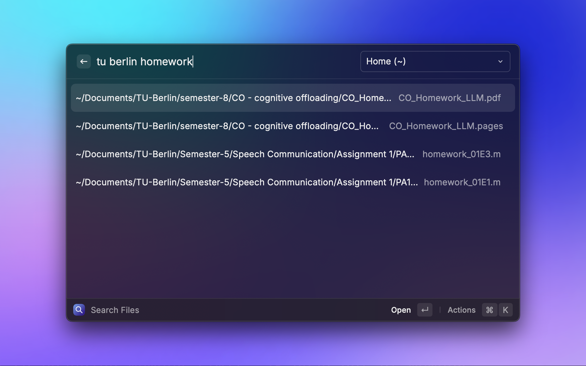

# Fuzzy File Search (TinyCast)

Based on the Fuzzy File Search extension from the Raycast Extensions repository.
Modified for TinyCast compatibility.

- Upstream: [raycast/extensions — extensions/fuzzy-file-search](https://github.com/raycast/extensions/tree/main/extensions/fuzzy-file-search) by erykksc (MIT, see [LICENSE](./LICENSE))
- Imported from upstream commit `29c078c4a74d44d4ea11fc1704ca143254663775` (2026-09-30)

Fuzzy-find files by their full path, not only by filename. Useful when the same file name (`README.md`) exists in many projects.



## Requirements

```bash
brew install fd fzf
```

The extension looks for `fd` and `fzf` in `/opt/homebrew/bin`, `/usr/local/bin`, then `PATH`. It no longer downloads them.

## Build and install in TinyCast

```bash
npm install
npm run build
```

`npm run build` runs `ray build -e dist -o dist`. In TinyCast, open **Settings → Extensions → Install → Add from folder** and pick the `dist/` folder (it contains `package.json`, `search-for-files.js` and `assets/`).

Remove the Store version of "Fuzzy File Search" from TinyCast first if it is installed; it crashes with `a.utimes is not a function`.

## What changed from upstream

TinyCast runs Raycast extensions on its own Node compatibility layer (checked against TinyCast 0.11.12):

| TinyCast behavior | Upstream relied on it in | Change |
|---|---|---|
| `fs.utimes` is missing | `proper-lockfile` in the fd/fzf downloaders | Downloaders removed; Homebrew `fd`/`fzf` used instead |
| `spawn` ignores the `stdio` option | fd wrote to an index file through `stdio`, fzf read it through `stdin` | `/bin/sh -c` does the redirection (`> index`, `< index`) |
| child output is only delivered when the process exits | results were capped at 200 by reading lines live and killing fzf | `fzf ... \| head -n 200` caps output inside the pipeline |
| `spawn`'s `signal` option is ignored | aborting a stale fd/fzf run | `kill()` on abort; the shell script kills its pipeline on SIGTERM |
| `process.env` is empty | — | Homebrew paths are checked explicitly |

Other changes:

- `fd` ignore rules are written to the extension's support directory and passed with `--ignore-file`, instead of creating `~/.config/fd/ignore`.
- `fzf` runs with `--scheme=path` so matches on path segments and file names rank higher.
- `Ignore Spaces in Search` now defaults to off: `plan readme` matches `plan` and `readme` as separate fuzzy terms.
- Removed dependencies: `proper-lockfile`, `@types/proper-lockfile`, `axios`, `extract-zip`, `tar`, `sha256-file` and their `@types/*`.

## How it works

- Every time you open the command it reindexes the selected search roots with `fd`. The index is written straight to a file in the extension support directory and never loaded into memory.
- Each query runs `fzf --filter` over that file and returns the top 200 matches.

## Configure the search

- `Include Directories`: show both directories and files (enabled by default).
- `Include Hidden`: surface dot-files and hidden folders.
- `Follow Symbolic Links`: descend into symlinked directories.
- `Ignore Spaces in Search`: strip spaces from the query so `src foo bar` behaves like `srcfoobar` (off by default).
- `Custom Search Directories`: space-separated list of roots. Use the search bar dropdown to switch between `Home (~)`, `Everything (/)`, or your custom set.

## Ignore rules

`fd` respects `.gitignore`, `.git/info/exclude`, `.ignore`, `.fdignore` and your own `~/.config/fd/ignore`. On top of that the extension always skips `/System`, `/Library`, `/private`, `/usr`, `/nix`, `~/Library/*` (except `~/Library/CloudStorage`) and `*.photoslibrary`.

## Tips

- Use `-d` to search directories only and `-f` to search files only (e.g. `sat -d`).
- Combine folder hints and filename fragments: `plan readme`, `plan/README`.

## Known limitations

- Indexing is not incremental: the selected roots are re-scanned each time the command opens (home with ~870k entries takes about 6 seconds). Cached results are shown meanwhile.
- If TinyCast is closed while indexing, `fd` finishes in the background; leftover `.temp` files are cleaned up on the next launch.
- Paths containing a newline are not supported (fzf output is newline-separated).

## Pulling upstream changes

```bash
git remote add upstream https://github.com/raycast/extensions.git   # once
git fetch --depth 100 --filter=blob:none upstream main
git diff --stat 29c078c4a74d44d4ea11fc1704ca143254663775 upstream/main -- extensions/fuzzy-file-search
git diff 29c078c4a74d44d4ea11fc1704ca143254663775 upstream/main -- extensions/fuzzy-file-search > upstream.patch
git apply -p3 --3way upstream.patch && rm upstream.patch
```

`-p3` strips the `extensions/fuzzy-file-search/` prefix. `--3way` works because the first commit of this repository is byte-identical to upstream at the recorded SHA. Patches touching `src/lib/fd-downloader.ts` / `fzf-downloader.ts` will fail since those files are gone here; port anything relevant to `src/lib/cli.ts` by hand. Then update the commit SHA above.
